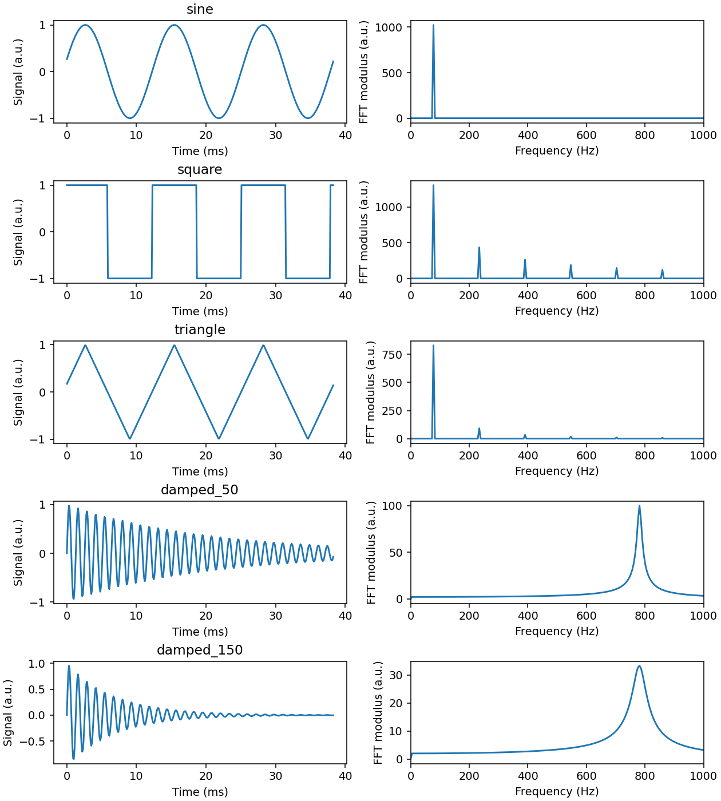

# Lab2-FFT

Solution to [Francesco Fuso's Laboratory 2 FFT exercise](https://osiris.df.unipi.it/~fuso/dida/fft_2016.pdf).

`analyze.py` generates a sine, square, and triangular wave, plus two damped
oscillations. It saves the generated signals in `data/` and plots their FFT spectra.

```bash
python -m pip install -r requirements.txt
python analyze.py
```

With 2048 samples separated by 100 microseconds, the frequency spacing is
4.8828125 Hz and the Nyquist frequency is 5000 Hz. The mean is subtracted to
remove the zero-frequency component; the plotted FFT modulus is unnormalized.

- **Sine:** one peak at 78.125 Hz.
- **Square:** odd harmonics, with amplitudes approximately proportional to 1/h.
- **Triangle:** odd harmonics, decreasing faster, approximately as 1/h².
- **Damped oscillation:** a peak near 781.25 Hz; stronger damping makes it lower
  and broader because the oscillations die out sooner.


