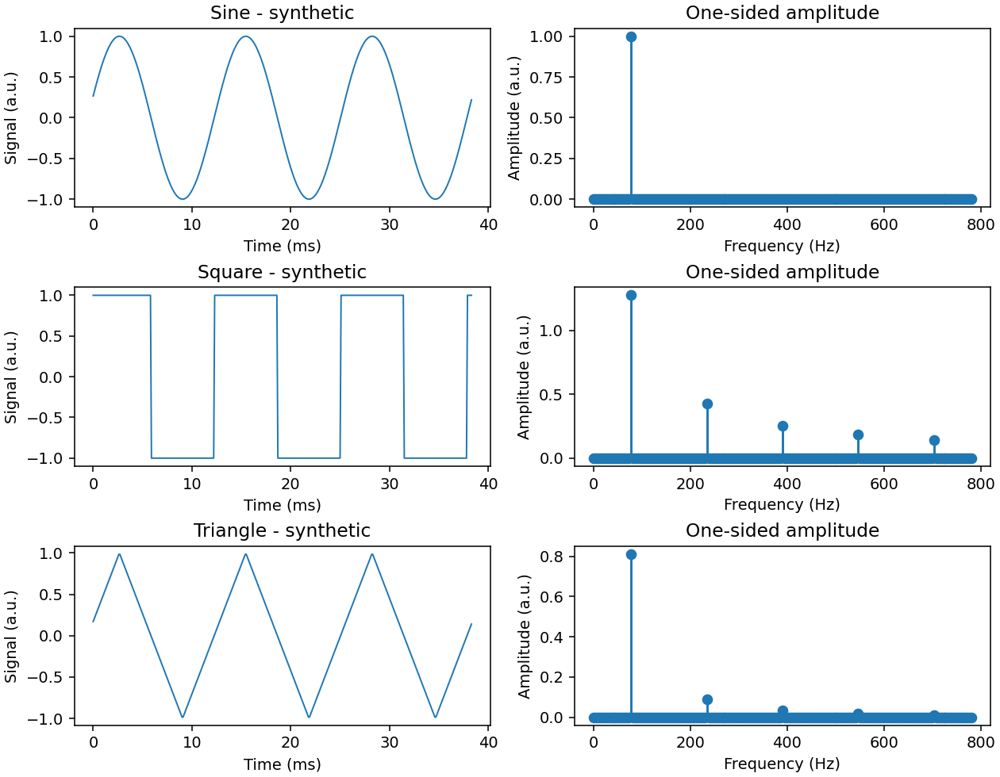
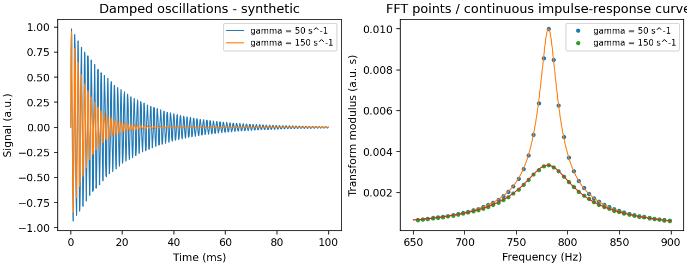
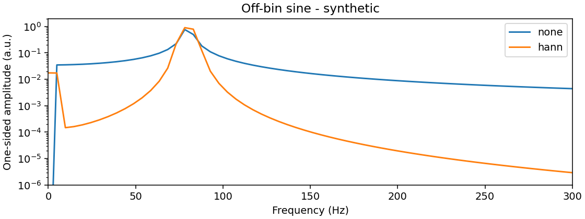

# FFT exercise: solution

## Scope

The [Laboratory 2 note by Francesco Fuso](https://osiris.df.unipi.it/~fuso/dida/fft_2016.pdf)
asks for Fourier spectra of recorded signals and comments relating them to the
known waveform or oscillator behaviour. Here the calculations use deterministic
synthetic signals because no original measurements were supplied. They establish
the expected results and provide an analysis procedure for actual recordings.
No experimental frequencies, noise levels, or component values are inferred.

## 1. From samples to frequencies

For N uniformly spaced samples x_j, separated by dt, NumPy uses

$$X_k=\sum_{j=0}^{N-1}x_j\exp(-2\pi i jk/N),\qquad f_k=\frac{k}{N\,dt}.$$

The opposite exponential sign in the course note changes the complex-conjugation
convention for a real signal, but leaves its modulus unchanged.

`np.fft.rfft` returns only the nonnegative-frequency coefficients: N//2 + 1
complex numbers. `np.fft.rfftfreq(N, dt)` supplies the matching frequencies.
A power-of-two length is convenient, but is not required by NumPy.

The sampling frequency is f_s = 1/dt. For even N the last frequency is the
Nyquist frequency f_s/2, beyond which distinct continuous frequencies can produce
the same samples (aliasing). The bin spacing is df = 1/(N dt).

The example uses N = 2048 and dt = 100 microseconds, so f_s = 10,000 Hz,
f_N = 5,000 Hz, T = N dt = 0.2048 s, and df = 4.8828125 Hz. T is the period
implicitly used by the DFT; the separation between the first and last timestamps
is (N-1)dt. For measured timestamps we estimate dt = (t_last-t_first)/(N-1).

The physical meaning is simple: sampling more frequently raises the observable
frequency range; observing for longer makes nearby frequencies easier to separate.
Appending zeros gives a finer plotting grid, but does not add information or
resolve previously unresolved components.

## 2. Amplitude normalization and offset

For an unwindowed record, the single-sided amplitude is |X_0|/N at DC and
2|X_k|/N at interior positive frequencies. For even N the Nyquist bin is also
|X_k|/N. The factor two joins the two equal-modulus contributions at positive
and negative frequencies. A bin-centred sine of peak amplitude A therefore gives
a spectral amplitude A.

The default analysis subtracts the mean, removing an irrelevant constant offset.
`--keep-mean` retains it. These outputs are amplitudes, not a power spectral
density. Their simple peak-amplitude interpretation applies to isolated periodic
components, rather than to an arbitrary transient.

For a Hann window, the code replaces N in the normalization by the sum of the
window weights. This corrects the window's attenuation for an isolated bin-centred
tone; it does not exactly recover an off-bin tone's amplitude from one peak bin.

## 3. Sine, square, and triangular waves

All three examples have unit peak amplitude, zero offset, and fundamental
frequency f_0 = 16 df = 78.125 Hz. The record contains exactly 16 cycles, which
avoids leakage caused by a partial final cycle. A fixed initial phase avoids
ambiguous square-wave samples exactly at a discontinuity.

An ideal sine has one nonzero positive-frequency component, at f_0. A symmetric
square wave has odd harmonics with amplitudes A_h = 4/(pi h). A symmetric
triangular wave has odd harmonics with amplitudes A_h = 8/(pi² h²).
Consequently, relative to the fundamental:

| Harmonic h | Square A_h/A_1 | Triangle A_h/A_1 |
|---|---:|---:|
| 1 | 1 | 1 |
| 3 | 0.333333 | 0.111111 |
| 5 | 0.200000 | 0.040000 |
| 7 | 0.142857 | 0.020408 |
| 9 | 0.111111 | 0.012346 |

The FFT values are saved in `results/harmonics.csv`. Small differences from the
continuous-wave coefficients remain because we transform finitely sampled
waveforms. Ideal square and triangular waves have infinitely many harmonics, so
sampling folds high harmonics into the observed band. The low-order harmonics
agree closely here; this is not a claim that these ideal signals are band-limited.

The faster decay for the triangle has a physical interpretation: its signal is
continuous, while the square wave jumps. A jump needs more high-frequency content
to reconstruct it. Both symmetric waveforms change sign after half a period;
that symmetry cancels the even harmonics.

## 4. Damped oscillation and resonance

Consider the underdamped displacement-like impulse response

$$x(t)=A e^{-\gamma t}\sin(\omega_d t),\quad t\geq0,\qquad
\omega_d=\sqrt{\omega_0^2-\gamma^2}.$$

With the same negative-exponential transform convention,

$$\widetilde{x}(f)=\frac{A\omega_d}{(\gamma+2\pi i f)^2+\omega_d^2}
=\frac{A\omega_d}{\omega_0^2-(2\pi f)^2+4\pi i\gamma f}.$$

This follows by writing the sine as two complex exponentials and integrating
each decaying exponential. For a linear oscillator driven by an impulse, this
transform is proportional to the corresponding transfer function. For a general
free oscillation, the initial phase and the measured circuit quantity matter:
one cannot identify every measured ringdown modulus with every RLC gain curve.
For example, measuring resistor voltage introduces a different frequency-dependent
numerator from measuring capacitor voltage.

We hold f_0 = omega_0/(2pi) = 781.25 Hz and A = 1 fixed and compare
gamma = 50 and 150 s^-1. The continuum modulus peaks at
sqrt(omega_0²-2gamma²)/(2pi), not exactly at omega_d/(2pi). In the weak-damping
limit both are close to f_0. Near that resonance the denominator is approximately
proportional to gamma + 2pi i(f-f_0).

The **power** |x_tilde|² then has full width at half maximum approximately
gamma/pi: 15.9155 and 47.7465 Hz. This is distinct from the width at half of the
modulus, approximately sqrt(3) gamma/pi. The quality factor is Q = omega_0/(2gamma).

Greater damping removes the oscillation sooner. Fewer coherent cycles mean a
less sharply defined frequency, so the peak broadens. With the initial amplitude
fixed, the integral also becomes smaller, lowering the peak. Normalizing both
spectra to their own maximum would hide this decrease.

For this transient we plot dt |X_k|, the Riemann-sum approximation to the
continuous transform, with units of signal times seconds. We neither subtract
the mean nor apply a Hann window: both would alter the chosen impulse response.
The finite sampled response is additionally checked against an exact geometric
sum in `damped_transform`, independently of the FFT. The plot compares with the
infinite-time continuous result; finite-record and sampling effects explain any
remaining difference. `results/damping.csv` records both peak locations and
the FFT-versus-discrete-reference discrepancy.

## 5. Interpreting imperfect measurements

A sine with 16.4 cycles in the record demonstrates **spectral leakage**: a finite
observation distributes even a pure sine over multiple FFT bins. The DFT treats
the record as one period; joining its ends introduces a discontinuity if they do
not match. A Hann window gradually suppresses the endpoints and reduces the distant
spectral tails, at the cost of broadening the central peak.

Therefore, peak broadening alone does not prove waveform distortion or damping.
Additional peaks may come from genuine harmonics, noise, aliasing, or leakage.
Timing variations also invalidate exact uniform sampling. The script reports
their largest relative spacing deviation and requires explicit opt-in above 1%.
This flag does not establish a bound on spectral error; using a mean time step
does not remove jitter. A proper treatment of strongly uneven sampling requires
a different method or a justified resampling model.

For original data, inspect the time trace first, establish the sampling interval,
then compare peak positions and harmonic ratios with these expectations. Report
the window, record duration, bin spacing, and amplitude convention. Bin spacing
alone is not a statistical error bar on the physical frequency.

## References

- [Course exercise](https://osiris.df.unipi.it/~fuso/dida/fft_2016.pdf)
- [NumPy real-input FFT](https://numpy.org/doc/stable/reference/generated/numpy.fft.rfft.html)
- [NumPy frequency bins](https://numpy.org/doc/stable/reference/generated/numpy.fft.rfftfreq.html)
